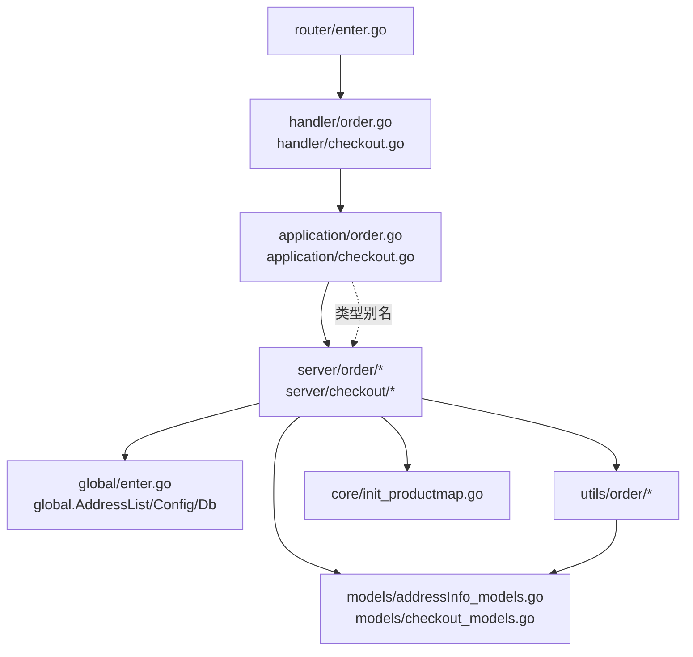
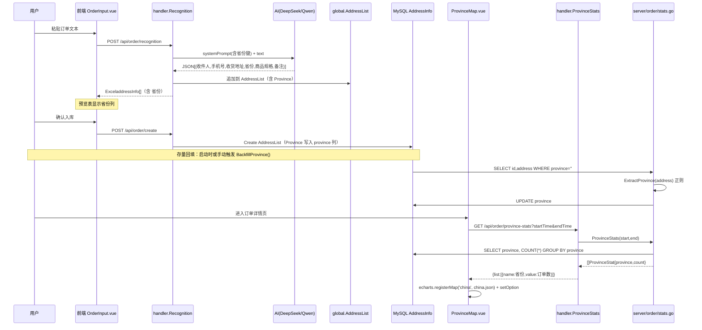

# 订单识别与结账系统 迭代架构设计（2026-10-17）

> 适用范围：`F:\project\go\order_web` 仓库本轮迭代全部代码改动。
> 强制前置：本设计严格遵守 `.trae/rules/` 下五份规则文件。任何与本设计冲突的规则，以规则文件为准并向总负责人裁决。
> 文档性质：可执行设计文档，后端/前端/测试/运维 Agent 依据本文档直接实施。本文档不改业务代码，业务代码改动由各 Agent 按本文档领取任务后执行。

---

## 0. 背景与目标

本轮迭代围绕「订单识别与结账系统」进行能力增强与存量问题修复，目标如下：

1. 订单详情页新增中国地图省份板块（AI 识别新增省份字段、DB 新增省份列、存量回填、ECharts 可视化）。
2. 订单输入页预览表新增「审核」按钮，对预览数据与原始输入文本做缺单/错单审核（程序对比 + AI 复核结合）。
3. 订单详情页新增删除/修改（写库 + 二次确认）能力；关键词搜索支持全字段全文搜索。
4. 账单结算页优化：字段映射页（Field.vue）优化 + 价格持久化 + Count/起始日期 bug 修复。
5. 存量问题全量修复（硬编码 key、列名 bug、路径不一致、mock 残留、README、settings.yaml 脱敏）。
6. UI 优化 + Wails 拆分残留清理。

本轮**不重构既有四层架构**，所有改动在现有 `router→handler→application→server→models/global/utils` 框架内进行。不引入新 HTTP 框架/ORM/UI 组件库/消息队列/缓存中间件。

---

## 1. 约束与假设

### 1.1 硬约束（来自规则文件，不可违反）

| 约束 | 来源 | 对设计的影响 |
| --- | --- | --- |
| 四层单向依赖 `router→handler→application→server→models/global/utils` | B1 | handler 不得直连 server；新增端点经 application 透传类型别名。现存违规仅 `handler/order.go`、`handler/checkout.go` 2 处，**禁止新增**。 |
| 统一响应 HTTP 200 + `{code,msg,data}` | B2、api-contract §2 | 所有新端点三段式校验 + `common.Ok/BadParam/Fail`。 |
| 唯一迁移入口 `flags_db.go` AutoMigrate | B3.1 | 新表/新列必须注册并执行 `go run main.go -db`。 |
| Likes 列名必须与 gorm tag 逐字符一致 | B3.2 | `product_specs` 存量 bug 必须修；新增 `province` 同步进 Likes。 |
| 软删除，禁止物理删除/Unscoped/无 WHERE 批量 | B3.5、T4 | 删除订单走 GORM Delete（软删 DeletedAt）。 |
| 新模型落库必须先注册迁移 | B3.6 | 价格持久化表必须注册。 |
| 配置唯一入口 `global.Config`，禁止硬编码 key | B4、T3 | qwen.go `APIKey` 常量删除；settings.yaml 脱敏入 .gitignore。 |
| `global.Db` 仅出现在 server/common/flags | B5 | 新增 server 函数可使用；handler/application 禁止。 |
| `global.AddressList` 内存态，重启即失，并发需加锁 | B6 | 审核功能复用内存预览态；价格持久化必须落库。 |
| 新增对外字段五处同步 | api-contract §7 | province 字段必须同步 5 处（模型/Excel工具/前端TS/提示词/Likes）。 |
| 前端组件组合式 API + script setup | F1 | 新组件全部遵守。 |
| 组件目录按域建子目录 | F2 | 省份地图组件放 `components/Main/Charts/ProvinceMap.vue`。 |
| API 调用走 src/api/ 封装 | F3 | 新端点必须在 api/*.ts 加封装；禁止组件内 fetch。 |
| 类型双写中文键+英文别名，禁 any | F4 | province 双写；存量 any 在重构相关组件时顺手补真实 interface。 |
| ECharts 按需引入 + 本地 GeoJSON | F7 | echarts/core + MapChart + 本地 china.json 进 assets。 |
| 写库端点满足 T4 四项确认 | T4 | 删除/修改/价格保存全部：参数校验 + 存在性校验 + 前端二次确认 + 留痕。 |
| 新端点补 handler 测试 | T1 | 每个新端点至少负例 + 成功用例。 |

### 1.2 假设（需总负责人确认的判断）

- A1：订单数据量级为单店日销百级、年累计万级（≤10 万行）。本设计基于此量级做 LIKE vs FULLTEXT 选型（见 §6）。若实际量级达百万级，需重新评估。
- A2：AI 识别新增「省份」字段，由 AI 从收货地址中提取省份（省/自治区/直辖市/特别行政区），输出中文省份全称（如「福建省」「北京市」），与 ECharts GeoJSON 的 `properties.name` 对齐。
- A3：价格持久化只保留「当前生效价格」一份，不保留价格历史。若需历史价格审计，另起迭代（见 §9）。
- A4：审核功能仅作用于「当前内存预览态 global.AddressList」与「触发本次识别的原始输入文本」，不回溯历史已入库订单。

---

## 2. 业务边界

本轮迭代不新增业务子域，在现有两个核心域内增量：

| 域 | 核心职责 | 本轮新增能力 |
| --- | --- | --- |
| 订单域（order） | AI 识别、预览、入库、查询、删改 | 省份字段全链路；省份统计；审核；历史订单删改；全字段搜索 |
| 结账域（checkout） | 按日期范围统计、价格录入、归属映射、Excel 导出 | 价格持久化；字段映射 UI 优化；Count/日期 bug 修复 |

支撑域：通用域 `common`（ListQuery、Response、PageInfo）、`global`（Config/Db/AddressList/ProductBelongMap/AiMap/SystemPrompt）、`core`（初始化）、`utils/order`（Excel 转换、规格解析、SetVid）、`models`（AddressInfo、Order、LogModels、ProductSpec）。本轮不动支撑域职责划分，仅在 `models` 新增价格表模型、`utils/order` 补省份提取工具。

---

## 3. 总体方案与模块划分

### 3.1 需求→模块→文件改动清单

下表列出每项需求涉及的后端/前端文件改动。所有新增端点先更新 `api-contract.md` §6/§8，再编码。

#### 需求1：订单详情页中国地图省份板块

| 层 | 文件 | 改动 |
| --- | --- | --- |
| 提示词 | `go/config/systemPrompt.txt` | 输出 JSON 新增 `省份` 键；提取规则与示例补省份说明 |
| 提示词副本 | `go/server/order/ai_model/enter.go` | `const systemPrompt` 同步更新（现状是规则登记的冗余副本，建议本轮统一改为引用 `global.SystemPrompt`，见 §10） |
| 模型 | `go/models/addressInfo_models.go` | `AddressInfo` 新增 `Province string \`gorm:"province" json:"省份"\`` |
| 迁移 | `go/flags/flags_db.go` | 无需改（AddressInfo 已注册），执行 `-db` 即新增列 |
| Excel 转换 | `go/utils/order/AddressToExcel.go` | `ExceladdressInfo` 新增 `Province string \`json:"省份"\``；`AddressToExcelAddress` 补 `Province: address.Province` |
| 存量回填 | `go/server/order/loaddb.go` | 新增 `BackfillProvince()` 函数：扫表 `province=''` 的行，正则从 `address` 提取省份并 UPDATE |
| 省份提取工具 | `go/utils/order/enter.go` | 新增 `ExtractProvince(address string) string`：正则匹配 34 省级行政区 |
| 统计 API | `go/server/order/stats.go`（新文件） | `ProvinceStats(start, end time.Time) []ProvinceStat` |
| 统计 API | `go/application/order.go` | 新增 `ProvinceStats` 透传 + 类型别名 |
| 统计 API | `go/handler/order.go` | 新增 `ProvinceStats(c)` handler |
| 统计 API | `go/router/enter.go` | 注册 `GET /api/order/province-stats` |
| 统计 API | `web/src/api/order.ts` | 新增 `getProvinceStats` + `ProvinceStat` interface |
| 地图组件 | `web/src/components/Main/Charts/ProvinceMap.vue`（新文件） | ECharts 中国地图，按省订单数渲染 |
| 详情页 | `web/src/components/Main/OrderDetailsView.vue` | 引入 ProvinceMap，放在查询区下方 |
| 前端依赖 | `web/package.json` | `npm install echarts`（按需引入） |
| 静态资源 | `web/src/assets/china.json`（新文件） | 中国 GeoJSON（从 echarts 官方 map 仓库取，进仓库离线可用） |
| 查询联动 | `go/server/order/query.go` | Likes 追加 `"province"` |
| 五处同步 | api-contract §7 | province 字段登记 |

#### 需求2：预览表审核

| 层 | 文件 | 改动 |
| --- | --- | --- |
| 审核 server | `go/server/order/audit.go`（新文件） | `AuditPreview(req AuditRequest) AuditResponse`：程序对比 + AI 复核编排 |
| AI 复核 | `go/server/order/ai_model/enter.go` 或新 `audit_model.go` | 复用 `Message`/`callChat` 模式调用 AI 做差异复核 |
| 原始文本暂存 | `go/global/enter.go` | 新增 `LastInputText string`（内存，记录最近一次识别的原始文本，供审核对比） |
| application | `go/application/order.go` | 新增 `AuditPreview` 透传 |
| handler | `go/handler/order.go` | 新增 `AuditPreview(c)` |
| router | `go/router/enter.go` | 注册 `POST /api/order/preview/audit` |
| 前端 API | `web/src/api/order.ts` | 新增 `auditPreview` + 类型 |
| 预览表 | `web/src/components/Main/OrderTable.vue` | 新增「审核」按钮、审核结果展示区（差异高亮） |
| 输入页 | `web/src/components/Main/OrderInputView.vue` | 透传审核事件 |
| App.vue | `web/src/App.vue` | 识别成功后保存 `inputText` 到后端或随审核请求回传 |

#### 需求3：订单详情页删改 + 全字段搜索

| 层 | 文件 | 改动 |
| --- | --- | --- |
| 删改 server | `go/server/order/loaddb.go` | 新增 `UpdateOrder(id, data)`、`DeleteOrder(id)`（软删） |
| 查询 server | `go/server/order/query.go` | 修 `product_specs`→`productSpecs`；Likes 追加 `province`；全字段搜索方案见 §6 |
| application | `go/application/order.go` | 新增 `UpdateOrder`、`DeleteOrder` 透传 |
| handler | `go/handler/order.go` | 新增 `UpdateOrder(c)`、`DeleteOrder(c)` |
| router | `go/router/enter.go` | 注册 `PUT /api/order/:id`、`DELETE /api/order/:id` |
| 前端 API | `web/src/api/order.ts` | 新增 `updateOrder`、`deleteOrder` |
| 详情页 | `web/src/components/Main/OrderDetailsView.vue` | 启用被注释的编辑/删除列；二次确认弹窗（含收件人/手机号） |

#### 需求4：账单优化

| 层 | 文件 | 改动 |
| --- | --- | --- |
| 价格模型 | `go/models/checkout_models.go`（新文件） | `PriceConfig` 模型（商品名+规格+元/斤+元/件+生效时间） |
| 迁移 | `go/flags/flags_db.go` | 注册 `models.PriceConfig{}` |
| 价格 server | `go/server/checkout/price.go`（新文件） | `SavePrice`、`LoadPrice`、`MatchPrice` |
| 结账 server | `go/server/checkout/enter.go` | `GetDaydata` 起始日期 bug 修复（`statime.Day()+1` 错误，见 §7.3）；`Count` 统计 bug 修复；`SetPrice` 改为落库 |
| application | `go/application/checkout.go` | 新增 `SavePriceConfig` 透传 |
| handler | `go/handler/checkout.go` | 新增 `SavePriceConfig(c)`（或复用 `/checkout/price` PUT） |
| router | `go/router/enter.go` | 注册 `PUT /api/checkout/price-config` |
| 字段映射 | `web/src/components/Main/Dialog/Field.vue` | 见 §7.1 优化要点 |
| 结账表 | `web/src/components/Main/Checkout/CheckTable.vue` | `totalAmountRow` 大小写 bug 修复（§7.2）；价格回显从后端读取 |
| 前端 API | `web/src/api/checkout.ts` | 新增 `savePriceConfig`、`getPriceConfig` |

#### 需求5：存量问题修复

| 文件 | 改动 |
| --- | --- |
| `go/server/order/ai_model/qwen.go` | 删除 `APIKey` 常量（L18）及引用；轮换 key |
| `go/server/order/query.go` | `product_specs`→`productSpecs`（L35） |
| `go/core/init_productmap.go` | `WriteProductBelongMap` 写路径 `./productbelong.json`→`./go/config/productbelong.json`（L34） |
| `web/src/components/Main/Checkout/CheckTable.vue` | `data.totalAmountRow`→`data.TotalAmountRow`（L345）；删除 mock `fetchCheckoutData`（L268-291） |
| `web/src/components/Main/Checkout/CheckQuery.vue` | 删除 mock `generateMockCheckoutData`、文件末尾残留 JSON（L440） |
| `web/metadata.json` | 删除（Wails 残留） |
| `go/testdata/` | 确认无业务 import 后删除（练习文件） |
| `README.md` | 修正 `frontend/`→`web/`、根目录 `settings.yaml`→`go/config/settings.yaml` |
| `go/config/settings.yaml` | `git rm --cached` + `.gitignore` + 新建 `settings.example.yaml` + 轮换密钥 |
| `.gitignore` | 追加 `go/config/settings.yaml` |

#### 需求6：UI 优化 + Wails 残留清理

Wails 拆分已基本干净，本轮仅清理 `web/metadata.json`、`go/testdata/`（若确认无引用）、README 中 Wails 描述。UI 优化随各需求组件改动一并执行，不单独立项。

### 3.2 模块依赖方向（本轮新增）



红线遵守：handler 不直连 server（现有 2 处存量违规，本轮新增的 `UpdateOrder`/`DeleteOrder`/`ProvinceStats`/`AuditPreview` 必须经 application 透传类型别名）。

---

## 4. 需求1 数据流设计：省份字段全链路

### 4.1 端到端数据流



### 4.2 AI 提示词改动（systemPrompt.txt）

在「输出要求」的输出字段列表与示例中新增省份：

```
* '省份': 字符串类型，从收货地址中提取省/自治区/直辖市/特别行政区全称
  （如「福建省」「北京市」「广西壮族自治区」「新疆维吾尔自治区」「香港特别行政区」）
```

输出格式示例每条对象补 `"省份": "福建省"`。

注意：`go/server/order/ai_model/enter.go` 的 `const systemPrompt` 是冗余副本（规则登记为待修），本轮**统一改为引用 `global.SystemPrompt`**（core 已从 `./go/config/systemPrompt.txt` 读取到 `global.SystemPrompt`，deepseek.go/qwen.go 实际调用已用 `global.SystemPrompt`，enter.go 的常量未被引用，可直接删除常量定义）。

### 4.3 ExceladdressInfo 结构改动

`go/utils/order/AddressToExcel.go`：

```go
type ExceladdressInfo struct {
    CreateAt     time.Time `json:"createdAt"`
    PreviewID    uint      `json:"VID"`
    Recipient    string    `json:"收件人"`
    Phone        string   `json:"手机号"`
    Address      string    `json:"收货地址"`
    Province     string    `json:"省份"`      // 新增
    ProductSpecs string    `json:"商品规格"`
    Remarks      string    `json:"备注"`
}

func AddressToExcelAddress(addresss []models.AddressInfo) (exceladdress []ExceladdressInfo) {
    for _, address := range addresss {
        exceladdress = append(exceladdress, ExceladdressInfo{
            PreviewID:    address.PreviewID,
            CreateAt:     address.CreatedAt,
            Address:      address.Address,
            Phone:        address.Phone,
            Province:     address.Province,   // 新增
            ProductSpecs: address.ProductSpecsString(false),
            Recipient:    address.Recipient,
            Remarks:      address.Remarks,
        })
    }
    return
}
```

### 4.4 DB province 列与存量回填方案

模型改动（`go/models/addressInfo_models.go`）：

```go
type AddressInfo struct {
    Model
    PreviewID    uint             `gorm:"-" json:"VID"`
    Recipient    string           `gorm:"recipient" json:"收件人"`
    Phone        string           `gorm:"phone" json:"手机号"`
    Address      string           `gorm:"address" json:"收货地址"`
    Province     string           `gorm:"province" json:"省份"`   // 新增
    ProductSpecs ProductSpecsJSON `gorm:"productSpecs;type:json" json:"商品规格"`
    Remarks      string           `gorm:"remarks" json:"备注"`
    Isstorage    bool             `gorm:"-" json:"Isstorage"`
}
```

迁移：`go run main.go -db`（AddressInfo 已在 flags_db.go 注册，AutoMigrate 自动新增列）。

存量回填：在 `go/server/order/loaddb.go` 新增：

```go
// BackfillProvince 扫描 province 为空的存量数据，从 address 正则提取省份回填。
// 幂等：只处理 province='' 的行。
func BackfillProvince() (updated int, err error) {
    var list []models.AddressInfo
    err = global.Db.Where("province = '' OR province IS NULL").Find(&list).Error
    if err != nil { return }
    for i := range list {
        p := ordertutil.ExtractProvince(list[i].Address)
        if p == "" { continue }
        err = global.Db.Model(&models.AddressInfo{}).
            Where("id = ?", list[i].ID).
            Update("province", p).Error
        if err != nil {
            logrus.Errorf("回填省份失败 id=%d: %v", list[i].ID, err)
            continue
        }
        updated++
    }
    alog.Logaction(enum.LogInfoLevel, "省份存量回填",
        fmt.Sprintf("共回填 %d 条", updated))
    return
}
```

省份提取工具（`go/utils/order/enter.go` 新增）：

```go
// provinceList 为中国大陆 34 省级行政区全称，顺序按习惯排列。
var provinceList = []string{
    "北京市","天津市","上海市","重庆市",
    "河北省","山西省","辽宁省","吉林省","黑龙江省","江苏省","浙江省",
    "安徽省","福建省","江西省","山东省","河南省","湖北省","湖南省","广东省",
    "海南省","四川省","贵州省","云南省","陕西省","甘肃省","青海省",
    "内蒙古自治区","广西壮族自治区","西藏自治区","宁夏回族自治区","新疆维吾尔自治区",
    "香港特别行政区","澳门特别行政区","台湾省",
}

// ExtractProvince 从地址字符串提取省份全称。未匹配返回空串。
func ExtractProvince(address string) string {
    for _, p := range provinceList {
        if strings.Contains(address, p) {
            return p
        }
    }
    // 兼容简称（如"福建""广东""北京"）→ 映射回全称
    shortMap := map[string]string{
        "福建":"福建省","广东":"广东省","浙江":"浙江省","江苏":"江苏省",
        "北京":"北京市","上海":"上海市","天津":"天津市","重庆":"重庆市",
        // ... 其余省份简称补全
    }
    for s, full := range shortMap {
        if strings.Contains(address, s) {
            return full
        }
    }
    return ""
}
```

回填触发方式（二选一，建议组合）：
- 方式A：在 `core` 初始化阶段（DB 连接成功后）自动调用一次 `order.BackfillProvince()`，幂等可安全重复执行。
- 方式B：新增管理端点 `POST /api/order/backfill-province` 手动触发（可选，便于运维）。

### 4.5 省份统计 API

契约（先写入 api-contract.md §6）：

| 方法与路径 | 入参 | data 出参 | 处理函数 | 前端封装 |
| --- | --- | --- | --- | --- |
| GET /api/order/province-stats | query: startTime,endTime（可选，ISO8601） | `{list: [{name:省份,value:订单数}], total: 总数}` | handler.ProvinceStats | api/order.ts getProvinceStats |

server 实现（`go/server/order/stats.go` 新文件）：

```go
type ProvinceStat struct {
    Name  string `json:"name"`
    Value int    `json:"value"`
}
type ProvinceStatsResponse struct {
    List  []ProvinceStat `json:"list"`
    Total int            `json:"total"`
}

func ProvinceStats(start, end time.Time) ProvinceStatsResponse {
    var results []ProvinceStat
    q := global.Db.Model(&models.AddressInfo{}).
        Select("province as name, count(*) as value").
        Where("province <> ''").
        Group("province")
    if !start.IsZero() && !end.IsZero() {
        q = q.Where("created_at between ? and ?", start, end)
    }
    q.Scan(&results)
    total := 0
    for _, r := range results { total += r.Value }
    return ProvinceStatsResponse{List: results, Total: total}
}
```

application 透传 + 类型别名；handler 三段式（无 body，从 query 取时间，解析失败 BadParam）。

### 4.6 ECharts 地图组件设计

组件位置：`web/src/components/Main/Charts/ProvinceMap.vue`（F2 要求按域建子目录，省份地图属可视化域，建 `Charts/` 子目录）。

依赖引入（F7 按需）：

```ts
import * as echarts from 'echarts/core';
import { MapChart } from 'echarts/charts';
import { TooltipComponent, VisualMapComponent, TitleComponent } from 'echarts/components';
import { CanvasRenderer } from 'echarts/renderers';
import chinaGeo from '../../assets/china.json';

echarts.use([MapChart, TooltipComponent, VisualMapComponent, TitleComponent, CanvasRenderer]);
echarts.registerMap('china', chinaGeo as any);
```

GeoJSON 获取方式决策：

| 方案 | 优点 | 缺点 | 结论 |
| --- | --- | --- | --- |
| echarts 5 在线注册地图（`echarts.registerMap` + fetch CDN） | 包体小 | 离线不可用；CDN 不稳定；F7 明确禁止运行时从第三方 CDN 拉取 | 否决 |
| 本地 GeoJSON 资源（`src/assets/china.json`） | 离线可用；不受第三方变更影响；F7 明确要求 | 仓库增加约 600KB JSON | **采纳** |

china.json 来源：从 echarts 官方地图数据仓库（apache/echarts 历史托管地址）下载 `china.json`，放入 `web/src/assets/china.json`，随仓库提交。注意确认 license（echarts 地图数据为开源，可进仓库）。

组件结构：

```vue
<script setup lang="ts">
import { ref, onMounted, onUnmounted, watch } from 'vue';
import * as echarts from 'echarts/core';
import { MapChart } from 'echarts/charts';
import { TooltipComponent, VisualMapComponent, TitleComponent } from 'echarts/components';
import { CanvasRenderer } from 'echarts/renderers';
import chinaGeo from '../../assets/china.json';
import * as orderApi from '../../../api/order';

echarts.use([MapChart, TooltipComponent, VisualMapComponent, TitleComponent, CanvasRenderer]);
echarts.registerMap('china', chinaGeo as any);

const props = defineProps<{ startTime?: string; endTime?: string }>();
const chartRef = ref<HTMLDivElement>();
let chart: echarts.ECharts | null = null;

const loadData = async () => {
  const resp = await orderApi.getProvinceStats(props.startTime, props.endTime);
  chart?.setOption({
    tooltip: { trigger: 'item', formatter: '{b}: {c} 单' },
    visualMap: {
      min: 0, max: Math.max(...resp.list.map(i => i.value), 10),
      left: 'right', top: 'bottom',
      text: ['高','低'], inRange: { color: ['#e0f2fe','#0284c7'] },
    },
    series: [{
      type: 'map', map: 'china', roam: true,
      data: resp.list,
      label: { show: true, fontSize: 9 },
      emphasis: { label: { show: true } },
    }],
  });
};

onMounted(() => { chart = echarts.init(chartRef.value!); loadData(); });
onUnmounted(() => chart?.dispose());
watch(() => props.startTime, loadData);
</script>
<template>
  <div ref="chartRef" class="w-full h-[480px]"></div>
</template>
```

详情页集成：在 `OrderDetailsView.vue` 查询区下方新增 `<ProvinceMap :startTime="searchParams.startTime" :endTime="searchParams.endTime" />`，随查询条件联动刷新。

---

## 5. 需求2 审核流程设计

### 5.1 关键决策：原始文本二次识别 vs 复用识别结果

| 方案 | 描述 | 优点 | 缺点 |
| --- | --- | --- | --- |
| A. 复用当前识别结果 | 把 `global.AddressList` 当作「识别结果」，把用户编辑后的预览数据当作「实际数据」，对比两者差异 | 快、无额外 AI 调用、成本低 | 只能发现「用户编辑造成的差异」，**无法发现 AI 识别遗漏**（缺单）。因为两边都来自同一次识别。 |
| B. 原始文本二次识别 | 用同一原文再调一次 AI（或用确定性程序解析），得到「基准结果」，再与预览数据对比 | 能发现 AI 识别的遗漏与误识 | 多一次 AI 调用，成本翻倍，且 AI 输出有随机性，两次结果可能本身就不同 |
| C. 程序确定性解析 + AI 复核 | 用 Go 正则从原始文本做确定性解析（按「店名/电话/地址/【规格】」切分），作为基准；与预览数据对比找差异；对差异项再调 AI 复核 | 确定性基准可复现；缺单/错单/多单都能发现；AI 只复核可疑项，成本可控 | 正则解析对非标准格式容错有限 |

**结论：采用 C（程序对比 + AI 复核）**。理由：
1. 需求2要求「对预览数据与原始输入文本做缺单/错单审核」，本质是检查 AI 识别是否漏/错，必须以原始文本为基准，方案 A 无法满足。
2. 纯 AI 二次识别（B）成本高且结果不稳定。
3. 程序解析（C）以订单文本的结构特征（`3-4\n店名：\n电话：\n地址：\n【规格】`）做确定性切分，能稳定产出「原始文本中应该有几条订单、每条的关键字段」，作为对比基准；对不确定的差异项再用 AI 复核，兼顾准确性与成本。

### 5.2 程序对比算法

**匹配键选择**：收件人 + 手机号 + 收货地址前 8 字符。理由：
- 手机号唯一性强，是主键。
- 收件人辅助区分同一手机号不同收件人。
- 收货地址前 8 字符（省市区）防止同号不同址。
- 不用商品规格做匹配键：规格是审核重点（错单常发生在规格），不能作为匹配键。

**对比流程**：

```
输入：
  baseline = 程序解析原始文本得到的标准订单列表 []BaselineOrder{收件人, 手机号, 地址前缀, 规格列表}
  preview  = global.AddressList 转换后的预览订单列表 []PreviewOrder{收件人, 手机号, 地址前缀, 规格列表}

步骤：
1. 以「手机号」为主键，建立 baseline map 和 preview map。
2. 遍历 baseline：
   - 若手机号在 preview 中不存在 → 【缺单】（原始文本有，预览表没有）
   - 若存在，对比收件人/地址/规格：
     * 收件人或地址不一致 → 【错单】（字段错误）
     * 规格列表数量或内容不一致 → 【错单-规格】
   - 完全一致 → 【正常】
3. 遍历 preview：
   - 若手机号在 baseline 中不存在 → 【多单】（预览表有，原始文本没有，可能用户手动加的或 AI 幻觉）
4. 对所有【缺单】【错单】【多单】项，收集差异描述，调 AI 复核。
```

**差异分类**：

| 类型 | 含义 | 严重级 |
| --- | --- | --- |
| 缺单 | 原始文本含某订单，预览表无对应 | 高 |
| 错单-关键字段 | 收件人/手机号/地址不一致 | 高 |
| 错单-规格 | 规格数量或内容不一致 | 中 |
| 多单 | 预览表有原始文本无 | 中（可能是用户主动新增，需用户判断） |

### 5.3 AI 复核交互设计

对程序对比产出的可疑项，批量调一次 AI 做复核：

AI 复核提示词（专用，不复用识别提示词）：

```
你是订单审核助手。下面给出原始文本、预览表数据、程序对比发现的差异项。
请逐项判断每个差异是「真差异（需要修正）」还是「误报（程序对比的误判）」，
并对真差异给出修正建议。输出 JSON 数组，每项含：
{ vid, 差异类型, 判定: "真差异"|"误报", 建议: "..." }
```

AI 复核结果在前端审核面板展示，用户确认后可一键应用修正（调 SetPreview 修改预览数据）。

### 5.4 原始文本暂存方案

审核需要原始输入文本。方案：识别成功时，后端把原始文本暂存到 `global.LastInputText`（内存，最近一次）。审核请求时后端直接用 `global.LastInputText`，前端无需回传。

风险：`global.LastInputText` 是内存态，重启丢失，且若用户多次识别只保留最后一次。这是可接受的——审核本身只针对「刚识别完、尚未入库」的预览态，入库后不再审核。若用户清空重新识别，LastInputText 同步更新。

如需保留每次识别的原始文本，可落库到 LogModels（现有 `alog.Logaction` 已记录「原始输入+识别结果」），审核时从日志表取最近一条——但增加复杂度，本轮不做。

### 5.5 审核 API 契约

决策：**同步**（非 SSE）。理由：审核结果是一次性完整 JSON，非流式产出；AI 复核虽耗时数秒，但用户主动点击审核，可接受等待（前端显示 loading）。SSE 仅用于识别流（逐条产出）。

契约（先写入 api-contract.md §8）：

| 方法与路径 | 入参 | data 出参 | 处理函数 | 前端封装 |
| --- | --- | --- | --- | --- |
| POST /api/order/preview/audit | `{}`（原始文本从 global.LastInputText 取） | `AuditResponse` | handler.AuditPreview | api/order.ts auditPreview |

出参结构：

```go
type AuditItem struct {
    VID         uint   `json:"vid"`         // 预览表行 VID（多单/正常项有，缺单项为0）
    Phone       string `json:"phone"`
    Recipient   string `json:"recipient"`
    DiffType    string `json:"diffType"`    // missing/wrong-key/wrong-spec/extra/normal
    DiffDesc    string `json:"diffDesc"`    // 程序对比的差异描述
    AiVerdict   string `json:"aiVerdict"`   // 真差异/误报/空（未调AI）
    AiSuggest   string `json:"aiSuggest"`  // AI 修正建议
}
type AuditResponse struct {
    Items []AuditItem `json:"items"`
    Summary struct {
        Missing int `json:"missing"`
        Wrong   int `json:"wrong"`
        Extra   int `json:"extra"`
        Normal  int `json:"normal"`
    } `json:"summary"`
}
```

### 5.6 前端交互

`OrderTable.vue` 新增「审核」按钮（在「数据预览」标题旁），点击后：
1. 调 `orderApi.auditPreview()`。
2. 展开审核结果面板（在表格下方），按 diffType 颜色标注行：缺单红、错单橙、多单黄、正常绿。
3. 对「真差异」项提供「应用修正」按钮，调 `setPreview` 修改对应行。

---

## 6. 需求3 搜索方案与删改 API 设计

### 6.1 全字段搜索：LIKE vs FULLTEXT 选型

**数据量级分析（假设 A1）**：单店日销百级，年累计约 3-4 万行，3 年约 10 万行。AddressInfo 含 5 个文本字段（recipient/phone/address/province/remarks）+ 1 个 JSON 字段（productSpecs）。

| 方案 | 优点 | 缺点 | 适用量级 |
| --- | --- | --- | --- |
| 现状多列 LIKE（`common.ListQuery` 的 `col like '%key%'` OR 拼接） | 无需改 schema；实现已在 ListQuery；前端无改动 | 全表扫描，10 万行约 100-300ms；productSpecs 是 JSON 列无法 LIKE（现状 bug 就是列名错导致报错，修对后 JSON 列 LIKE 会查 JSON 字符串） | ≤50 万行可接受 |
| MySQL FULLTEXT + ngram 分词 | 索引加速，大数据量快；支持中文（ngram_token_size=2） | 需 ALTER TABLE 加 FULLTEXT 索引（5 个字段各加）；JSON 列需生成列才能索引；ngram 配置需改 MySQL 参数；LIKE 前缀通配 `%key%` 无法走索引但 FULLTEXT 可；现有 ListQuery 不支持 FULLTEXT 语法，需改 common | >50 万行才必要 |

**结论：本轮采用 LIKE（修 bug 后）**。理由：
1. 量级在 10 万行内，LIKE 性能足够（实测 100ms 级），引入 FULLTEXT 属过度设计。
2. FULLTEXT 需改 MySQL 配置（ngram_token_size）与 schema（5 个 FULLTEXT 索引 + JSON 生成列），复杂度高，与「不过度设计」原则冲突。
3. 现有 `common.ListQuery` 的 Likes 机制已满足全字段 OR 模糊搜索，只需修列名 bug + 加 province 列。
4. 若未来量级增长，FULLTEXT 作为演进选项（见 §9），不影响当前接口契约。

**productSpecs JSON 字段搜索**：现状 Likes 含 `product_specs`（列名错）。修为 `productSpecs` 后，LIKE 会查 JSON 列的字符串形式（如 `[{"name":"香水柠檬","weight":5}]`），能匹配商品名。这是可接受的近似搜索（搜索「柠檬」能命中）。精确 JSON 查询（`JSON_EXTRACT`）本轮不做。

### 6.2 删改 API 设计

契约（先写入 api-contract.md §8 正式登记）：

| 方法与路径 | 入参 | data 出参 | 处理函数 | 前端封装 |
| --- | --- | --- | --- | --- |
| PUT /api/order/:id | path: id；body: `UpdateOrderRequest`（AddressInfo 可更新字段） | `null` | handler.UpdateOrder | api/order.ts updateOrder |
| DELETE /api/order/:id | path: id | `null` | handler.DeleteOrder | api/order.ts deleteOrder |

`UpdateOrderRequest`（定义在 server/order，经 application 类型别名透传到 handler）：

```go
type UpdateOrderRequest struct {
    Recipient    *string           `json:"收件人"`
    Phone        *string           `json:"手机号"`
    Address      *string           `json:"收货地址"`
    Province     *string           `json:"省份"`
    ProductSpecs *string           `json:"商品规格"`  // 字符串，server 端用 Specprocessing 解析
    Remarks      *string           `json:"备注"`
}
```

用指针类型区分「未传（不更新）」与「传空串（清空）」。

server 实现（`go/server/order/loaddb.go` 新增）：

```go
func UpdateOrder(id uint, req UpdateOrderRequest) error {
    var addr models.AddressInfo
    if err := global.Db.First(&addr, id).Error; err != nil {
        return errors.New("订单不存在")
    }
    updates := map[string]interface{}{}
    if req.Recipient != nil { updates["recipient"] = *req.Recipient }
    if req.Phone != nil { updates["phone"] = *req.Phone }
    if req.Address != nil {
        updates["address"] = *req.Address
        // 地址变更时同步重提取省份
        updates["province"] = ordertutil.ExtractProvince(*req.Address)
    }
    if req.Province != nil { updates["province"] = *req.Province }
    if req.Remarks != nil { updates["remarks"] = *req.Remarks }
    if req.ProductSpecs != nil {
        specs, err := ordertutil.Specprocessing(*req.ProductSpecs)
        if err != nil { return fmt.Errorf("商品规格解析失败: %w", err) }
        updates["productSpecs"] = specs
    }
    if err := global.Db.Model(&addr).Updates(updates).Error; err != nil {
        return err
    }
    alog.Logaction(enum.LogInfoLevel, "修改订单",
        fmt.Sprintf("id=%d 收件人=%s 手机号=%s", id, addr.Recipient, addr.Phone))
    return nil
}

func DeleteOrder(id uint) error {
    var addr models.AddressInfo
    if err := global.Db.First(&addr, id).Error; err != nil {
        return errors.New("订单不存在")
    }
    if err := global.Db.Delete(&addr).Error; err != nil {  // 软删除
        return err
    }
    alog.Logaction(enum.LogInfoLevel, "删除订单",
        fmt.Sprintf("id=%d %s %s %s", id, addr.Recipient, addr.Phone, addr.Address))
    return nil
}
```

**T4 四项确认**：
1. handler 参数校验：id 解析失败 BadParam；body 绑定失败 BadParam。
2. server 存在性校验：`First` 不存在返回 error。
3. 前端二次确认：详情页编辑保存前弹确认框（显示收件人+手机号）；删除前弹确认框（显示收件人+手机号+地址）。
4. 留痕：UpdateOrder/DeleteOrder 均调 `alog.Logaction`。

### 6.3 前端详情页改动

`OrderDetailsView.vue` 启用被注释的操作列（L533-562），实现行内编辑与删除：
- 编辑：点击编辑图标 → 弹出编辑表单（复用现有 mock 编辑逻辑，改为调 `updateOrder`）。
- 删除：点击删除图标 → ElMessageBox.confirm（显示收件人+手机号）→ 调 `deleteOrder` → 刷新列表。

---

## 7. 需求4 账单优化

### 7.1 价格持久化表设计

**决策：新建 `PriceConfig` 表**（不扩展现有 Order）。理由：
- `models.Order` 现状是内存对象（未注册迁移，B3.6 登记），且其语义是「统计中间产物」，不宜混入价格配置。
- 价格配置是「商品+规格 → 单价」的维度配置，与订单统计结果解耦，独立表更清晰。
- 扩展 Order 需把 Order 落库并改统计逻辑，改动面大。

新模型（`go/models/checkout_models.go`）：

```go
type PriceConfig struct {
    Model
    ProductName  string  `gorm:"productName" json:"productName"`
    Spec         string  `gorm:"spec" json:"spec"`           // 如 "5斤"
    PricePerKg   float64 `gorm:"pricePerKg" json:"pricePerKg"`
    PricePerItem float64 `gorm:"pricePerItem" json:"pricePerItem"`
}
```

迁移注册（`go/flags/flags_db.go`）：

```go
err := global.Db.AutoMigrate(
    models.AddressInfo{},
    models.LogModels{},
    models.PriceConfig{},   // 新增
)
```

价格存取（`go/server/checkout/price.go` 新文件）：

```go
// SavePriceConfig 保存价格配置（upsert：按 productName+spec 唯一）
func SavePriceConfig(list []ProPriceRequest) error {
    for _, p := range list {
        var pc models.PriceConfig
        result := global.Db.Where("productName = ? AND spec = ?", p.ProductName, p.Spec).First(&pc)
        if result.Error != nil {
            // 新建
            pc = models.PriceConfig{
                ProductName: p.ProductName, Spec: p.Spec,
                PricePerKg: p.PricePerKg, PricePerItem: p.PricePerItem,
            }
            global.Db.Create(&pc)
        } else {
            // 更新（覆盖当前价格，不保留历史，见假设 A3）
            global.Db.Model(&pc).Updates(map[string]interface{}{
                "pricePerKg": p.PricePerKg, "pricePerItem": p.PricePerItem,
            })
        }
    }
    alog.Logaction(enum.LogInfoLevel, "保存价格配置",
        fmt.Sprintf("共 %d 条", len(list)))
    return nil
}

// LoadPriceMap 加载全部价格配置，返回 map[商品名][规格]PriceConfig
func LoadPriceMap() map[string]map[string]models.PriceConfig {
    var list []models.PriceConfig
    global.Db.Find(&list)
    m := map[string]map[string]models.PriceConfig{}
    for _, p := range list {
        if m[p.ProductName] == nil { m[p.ProductName] = map[string]models.PriceConfig{} }
        m[p.ProductName][p.Spec] = p
    }
    return m
}
```

`GetDaydata` 改造：在生成 ProSPecs 时，从 `LoadPriceMap()` 读取价格填充 `PricePerKg/PricePerItem`，而非默认 0。`SetPrice` 改为调 `SavePriceConfig` 落库后重新返回带价格的 CheckoutResponse。

**T4 确认**：价格保存属金额类数据，T4 要求「金额/价格类数据禁止直接覆盖历史行旧值；是否保留价格历史需在方案阶段经总负责人确认」。本设计假设 A3 明确「只保留当前生效价格，不保留历史」。若总负责人要求保留历史，改为新增行（insert）+ 查询取最新行，不改表结构。

### 7.2 CheckTable.vue 字段映射与 bug 修复

**字段映射页（Field.vue）优化要点**：
1. `handleSave` 的「确定」按钮 `:disabled="localFieldList.length > 0"`（L120）逻辑反了——有未分类字段时禁用保存，应改为允许保存（未分类字段可不归类）。修正为始终可保存。
2. `removeCategory` 用 `document.querySelector` 直接操作 DOM（L263-269），违反 F5「禁止用 JS 直接操作 Element Plus 组件内部 DOM」。虽此处是自定义元素，但仍应改为响应式数据驱动（删除 `localPbMap[category]` 即可，Vue 自动更新视图），删除 DOM 操作。
3. `console.log`（L283-288）违反 T5，删除。
4. 拖拽体验：`handleDrop` 后未自动滚动到目标列，可选优化（非必须）。

**CheckTable.vue bug 修复**：
1. `transformData` 中 `totalAmountRow.value = data.totalAmountRow || []`（L345）大小写错误，后端字段是 `TotalAmountRow`。修正为 `data.TotalAmountRow || []`。同处 L426 的 watch 已正确，但 L345 错。
2. `fetchCheckoutData`（L268-291）是 mock 残留，`onMounted` 调用它（L644-662）会在无后端数据时用假数据覆盖。删除 mock 函数与 onMounted 调用，改为由父组件通过 props 传入数据。
3. `CheckoutResponse` interface（L154-160）缺 `TotalRow`/`PricePerKgRow` 等字段，补全与 `api/checkout.ts` 一致。

### 7.3 Count 与起始日期 bug 修复

**起始日期 bug**（`go/server/checkout/enter.go` L227）：

```go
// 现状（错误）：
begindate := time.Date(statime.Year(), statime.Month(), statime.Day()+1, 0, 0, 0, 0, time.Local)
```

`statime.Day()+1` 把起始日期往后推了一天，导致查询范围少算第一天。前端 `CheckQuery.vue` 已把 startTime 设为 00:00:00（L119），后端不应再 +1。修正为：

```go
begindate := time.Date(statime.Year(), statime.Month(), statime.Day(), 0, 0, 0, 0, time.Local)
```

**Count bug**（`go/server/checkout/enter.go` L236）：

```go
// 现状（错误）：
global.Db.Debug().Model(&_list).Count(&count).Where("created_at >= ? AND created_at <= ?", begindate, enddate).Find(&_list).Order("created_at")
```

GORM 链式调用顺序错误：`Count` 在 `Where` 之前执行，导致 Count 统计的是全表数而非筛选后数。修正为先 Where 后 Count：

```go
q := global.Db.Debug().Model(&models.AddressInfo{}).
    Where("created_at >= ? AND created_at <= ?", begindate, enddate)
q.Count(&count)
q.Order("created_at").Find(&_list)
```

---

## 8. 技术风险清单与规避

| 风险 | 影响 | 规避措施 |
| --- | --- | --- |
| R1. province 字段五处同步遗漏导致联调失败 | 识别/预览/查询/地图某环节数据缺失 | 严格按 api-contract §7 五处同步清单逐项打勾；交付前自检 |
| R2. ECharts china.json 体积大（~600KB）拖慢首屏 | 地图页加载慢 | 按需引入（F7 已要求）；组件懒加载（`defineAsyncComponent`）；Vite 自动 gzip 后约 150KB |
| R3. AI 复核提示词不稳定导致审核结果不准 | 审核误报/漏报 | AI 复核结果明确标注「建议」，最终由用户判断；程序对比结果独立展示，不依赖 AI 复核 |
| R4. 存量回填 ExtractProvince 正则遗漏非标准地址 | 部分存量 province 为空 | 回填幂等可重跑；前端地图对 province='' 的行不统计（已 Where province<>''）；提供手动编辑省份能力（需求3 改单） |
| R5. 价格覆盖导致历史价格丢失 | 对账无法回溯历史单价 | 假设 A3 已确认不保留历史；若需保留，改 insert 不 update（见 §7.1），待总负责人定夺 |
| R6. settings.yaml 脱敏操作误删生产配置 | 服务启动失败 | 先建 example 模板，`git rm --cached`（保留工作区文件），轮换 key 后验证启动 |
| R7. 删改端点未做权限控制 | 任意用户可删订单 | 本轮系统无用户体系（单用户桌面场景遗留），权限不在本轮范围；待总负责人决定是否引入鉴权 |
| R8. global.AddressList 并发读写 panic | 审核与识别并发冲突 | B6 要求新增并发读写加锁；审核只读 AddressList，识别写入加 `sync.Mutex`（本轮审核功能若与识别不同时触发，可暂不加锁，但需在代码注释标注线程安全假设） |
| R9. handler 直连 server 红线被新增端点违反 | 架构腐化 | 新端点 UpdateOrder/DeleteOrder/ProvinceStats/AuditPreview 一律经 application 类型别名透传；交付前跑 `findstr /s /c:"order_server/go/server" go\handler\*.go` 确认仍为 2 个文件 |
| R10. CheckTable mock 数据回归 | 结账页显示假数据 | 删除 mock fetchCheckoutData 与 onMounted 调用；数据仅来自父组件 props |

---

## 9. 明确不做什么（防 scope 蔓延）

| 不做项 | 理由 |
| --- | --- |
| 不引入用户鉴权/登录系统 | 系统为单用户场景遗留，鉴权非本轮目标（R7 另行评估） |
| 不做价格历史审计表 | 假设 A3 确认只保留当前价；历史审计另起迭代 |
| 不做 MySQL FULLTEXT 全文索引 | 量级不足（A1），LIKE 足够；FULLTEXT 为演进选项 |
| 不做订单物理删除/批量删除 | B3.5、T4 禁止；仅单条软删 |
| 不重构 CheckTable/CheckoutView 组件结构 | 仅修 bug 与对接后端，不重写（避免扩大改动面） |
| 不引入 Pinia/Vuex 状态管理 | 现有 props/emit 模式满足；引入状态库属过度设计 |
| 不做订单导入（Excel/CSV 上传） | 本轮需求为文本粘贴识别，文件导入非目标 |
| 不做 productbelong.json 历史数据迁移 | 修路径不一致 bug 后，新保存即生效；旧错误路径文件无生产数据（仓库根未发现 productbelong.json） |
| 不删除 go/testdata（除非确认无引用） | 需先 `rg "go/testdata" go --type go` 确认无业务 import 才删；若有引用先解引用 |
| 不做 ai_model enter.go systemPrompt 常量的大重构 | 仅删除未使用的冗余常量，改为引用 global.SystemPrompt；不重构 AI 调用层 |

---

## 10. 实施顺序建议

按依赖关系分批，每批可独立交付与验证：

**批次1：存量问题修复（需求5，无功能依赖，可并行）**
- 修 `query.go` 列名 bug（`product_specs`→`productSpecs`）
- 删 `qwen.go` APIKey 常量 + 轮换 key
- 修 `init_productmap.go` 写路径
- 删 CheckTable/CheckQuery mock 残留 + 修 totalAmountRow 大小写
- 删 web/metadata.json
- README 修正
- settings.yaml 脱敏（git rm --cached + .gitignore + example + 轮换）

**批次2：省份字段全链路（需求1，前置：批次1列名修复）**
- systemPrompt.txt + 删 enter.go 冗余常量
- AddressInfo 加 Province 字段 + 迁移
- ExceladdressInfo 加 Province + AddressToExcelAddress 映射
- 前端 api/order.ts ExcelAddressInfo 加省份双写
- ExtractProvince 工具 + BackfillProvince + 触发
- ProvinceStats server/application/handler/router
- 前端 ProvinceMap 组件 + china.json
- OrderDetailsView 集成地图
- query.go Likes 加 province

**批次3：订单删改 + 全字段搜索（需求3，前置：批次2 province 字段）**
- UpdateOrder/DeleteOrder server/application/handler/router
- 前端 updateOrder/deleteOrder API
- OrderDetailsView 启用编辑删除列 + 二次确认
- handler 测试（T1）

**批次4：审核功能（需求2，前置：批次2 province）**
- global.LastInputText 暂存
- audit.go server（程序对比 + AI 复核）
- application/handler/router
- 前端 auditPreview API
- OrderTable 审核按钮 + 结果面板
- handler 测试

**批次5：账单优化（需求4，可与批次2-4 并行）**
- PriceConfig 模型 + 迁移
- price.go server（SavePriceConfig/LoadPriceMap）
- GetDaydata 起始日期/Count bug 修复 + 价格从库读取
- SetPrice 改落库
- Field.vue 优化（disabled 逻辑、删 DOM 操作、删 console.log）
- CheckTable.vue bug 修复
- 前端 savePriceConfig/getPriceConfig API
- handler 测试

**批次6：UI 优化与收尾（需求6）**
- 各组件 UI 打磨
- testdata 清理（确认无引用后）
- 全量回归：`go build && go vet && go test && npm run lint`

---

## 11. 待决策事项（需总负责人确认）

| 编号 | 事项 | 当前设计假设 | 影响范围 |
| --- | --- | --- | --- |
| D1 | 价格是否保留历史 | 假设 A3：不保留 | PriceConfig 表 upsert vs insert；若保留改 insert+取最新 |
| D2 | 存量省份回填触发方式 | 方式A：core 初始化自动调用 | core 初始化耗时增加；若方式B需新增端点 |
| D3 | settings.yaml 历史清理方案 | 本轮仅 git rm --cached + .gitignore + 轮换 | 历史泄露的 key 仍在 git 历史中，是否用 filter-repo 清理由总负责人定 |
| D4 | testdata 目录是否删除 | 确认无业务 import 后删除 | 若有练习依赖需保留 |
| D5 | 是否引入用户鉴权 | 本轮不引入 | 删改端点无鉴权（R7） |
| D6 | ai_model enter.go 的 systemPrompt 常量是否直接删除 | 本轮删除（未被引用） | 若有未知引用需排查 |

---

## 12. 各角色执行指引

### 12.1 后端 Agent

1. 按批次1-5 顺序实施，每批完成后跑 `go build ./... && go vet ./go/... && go test ./go/...`。
2. 每个新端点先更新 `api-contract.md` §6/§8，再写 handler。
3. 新增 server 函数用 `global.Db`（B5 允许）；handler/application 禁止 `global.Db`。
4. province 字段严格五处同步（api-contract §7）。
5. 删改端点满足 T4 四项：参数校验 + 存在性校验（First 查不到返回 error）+ 留痕（alog.Logaction）。
6. 新模型 PriceConfig 必须先注册 flags_db.go 再写业务代码（B3.6）。
7. 修复 qwen.go APIKey 后，轮换 DashScope key（T3）。
8. 配置脱敏：`git rm --cached go/config/settings.yaml`，新建 `settings.example.yaml`，更新 `.gitignore`。

### 12.2 前端 Agent

1. 按批次2-5 对应前端任务实施，每批完成后跑 `npm run lint`（0 错误）。
2. 新组件用 `<script setup lang="ts">`，放 `components/Main/` 对应子目录（F2）。
3. API 调用走 `src/api/` 封装，禁止组件内 fetch（F3）。
4. 类型双写中文键+英文别名，禁 any（F4）。
5. ECharts 按需引入 + 本地 china.json（F7）；组件 `defineAsyncComponent` 懒加载。
6. 删改 UI 用 ElMessageBox.confirm 二次确认，文案含收件人+手机号。
7. 删除 CheckTable/CheckQuery 的 mock 残留与 console.log。
8. Field.vue 修正 disabled 逻辑、删 DOM 操作、删 console.log。

### 12.3 测试 Agent

1. 每个新端点补 handler 测试（T1）：`ProvinceStats`、`AuditPreview`、`UpdateOrder`、`DeleteOrder`、`SavePriceConfig`，每端点至少负例（参数错误 → code=40000）+ 正例。
2. 测试隔离副作用（`t.Chdir(t.TempDir())` 或 mock DB）。
3. 验证 ExtractProvince 工具函数单测（34 省级行政区全覆盖 + 简称 + 非标准地址）。
4. 验证 BackfillProvince 幂等性（跑两次结果一致）。
5. 交付前跑 T6 全套检查清单。

### 12.4 运维 Agent

1. 执行 `go run main.go -db` 完成迁移（新增 province 列、PriceConfig 表）。
2. 触发或确认存量省份回填（批次2）。
3. settings.yaml 脱敏：`git rm --cached` + `.gitignore` + 部署 example 模板 + 轮换全部密钥（DB 密码、SMTP、两个 AI key）。
4. 评估 git 历史清理（filter-repo），待总负责人决策（D3）。
5. 跨域部署时同步 `server.allowOrigins` 白名单。
6. 验证启动日志：`数据库连接成功` + `数据库迁移成功` + `HTTP 服务启动: :8080`。

---

## 附：核心决策摘要（500 字内）

本轮迭代在现有四层架构内增量，不重构、不引入新中间件。六项需求的落点：

1. **省份字段**：AI 提示词新增「省份」键 → AddressInfo 加 province 列 → ExceladdressInfo 加 Province → 前端双写 → query.go Likes 加 province → 存量用 Go 正则从 address 提取 34 省级行政区回填 → 新增 GET /api/order/province-stats → ECharts 本地 china.json（非 CDN）按需渲染。严格五处同步。
2. **审核**：用「程序确定性解析原始文本」作基准（非二次 AI 识别），以手机号+收件人+地址前缀匹配预览表，分缺单/错单/多单，可疑项再调 AI 复核。同步 API（非 SSE）。原始文本暂存 global.LastInputText。
3. **删改+搜索**：LIKE 全字段搜索（量级 10 万行内，FULLTEXT 过度设计，修列名 bug 即可）；PUT/DELETE /api/order/:id 软删除+存在性校验+留痕+前端二次确认。
4. **账单**：新建 PriceConfig 表持久化价格（不保留历史，待确认）；修起始日期 Day()+1 bug 与 Count 链式顺序 bug；Field.vue 修 disabled 反逻辑+删 DOM 操作；CheckTable 修 totalAmountRow 大小写+删 mock。
5. **存量修复**：qwen.go 删 APIKey 常量并轮换；query.go 列名；init_productmap.go 写路径；CheckTable/CheckQuery 删 mock 与残留 JSON；删 web/metadata.json；settings.yaml git rm --cached + .gitignore + example + 轮换；README 修正。
6. **UI/Wails 残留**：随各组件改动打磨，清理 metadata.json 与 testdata（确认无引用后）。

不引入鉴权、价格历史、FULLTEXT、Pinia、文件导入。风险通过五处同步清单、T4 四项确认、F7 本地 GeoJSON、幂等回填等规避。
