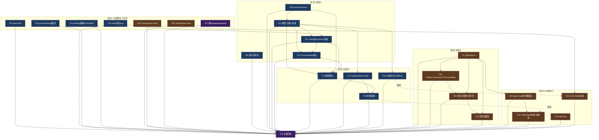

# 订单识别与结账系统 迭代研发任务规划（2026-10-17）

> 上游依据（规划唯一依据，任务不得超出其范围）：
> 1. `docs/design/2026-10-17-iteration-architecture.md`（架构设计）
> 2. `docs/design/2026-10-17-db-and-api-contract.md`（数据库与 API 契约）
> 3. `.trae/rules/` 全部 5 个规则文件（B1-B7 / F1-F8 / T1-T6 / api-contract / project-overview）
>
> 总负责人已裁定：价格 upsert 不留历史（RUL-1）、省份迁移后自动幂等回填（RUL-2）、全字段 LIKE 不引入 FULLTEXT（RUL-3）、不重写 git 历史、不引入鉴权、订单软删除、ECharts 本地 china.json（含九段线完整版，禁止 CDN）、审核采用程序对比（Go 正则解析原始文本）+ AI 复核可疑项、审核按钮位于订单输入页预览表区域、数据浏览即预览表（OrderTable）。
>
> 任务状态枚举：待处理 / 进行中 / 待验证 / 已完成 / 受阻。标记"已完成"必须同时满足验收标准与可核验证据（命令输出、测试记录、联调结果）。
> 行号说明：文中行号以 2026-10-17 代码现状为准，实施时以实际代码内容定位，行号漂移不作为阻塞理由。

---

## 1. 角色与文件所有权边界

### 1.1 负责角色

| 角色 | 职责范围 |
| --- | --- |
| go-backend-developer | `go/**` 全部 Go 代码、`go/config/systemPrompt.txt`、仓库根 `main.go`（本轮不改） |
| vue3-frontend-developer | `web/src/**`、`web/package.json`、`web/metadata.json`（删除） |
| 两者 | 删除类/仓库卫生类任务（T07、T25）由一方执行即可，默认 go-backend-developer 执行 T07、双方共同执行 T25 各自部分 |

### 1.2 文件所有权与共享文件修改流程

| 类别 | 文件 | 约束 |
| --- | --- | --- |
| 后端独占 | `go/**`（含 `go/config/systemPrompt.txt`） | 前端 Agent 禁止修改 |
| 前端独占 | `web/src/**`、`web/package.json` | 后端 Agent 禁止修改 |
| 后端任务涉及（本轮授权范围） | `.gitignore`、`README.md`、`go/config/settings.example.yaml`（新建） | 仅 T04 修改；settings.yaml 的 `git rm --cached` 已获总负责人授权 |
| 删除类（本轮授权范围） | `web/metadata.json`、`go/testdata/**` | 仅 T07 修改；已核实 `go/testdata` 无业务 import（`rg "go/testdata" --type go` 无命中）、metadata.json 为 Wails 残留 |
| 契约文件 | `.trae/rules/api-contract.md` | **任何 Agent 不得自行修改**。本轮契约已登记（第 6/8 节）。实施中发现契约缺陷 → 上报总负责人 → 批准后先改契约再改代码（契约优先） |
| 本任务文档 | `docs/plan/2026-10-17-iteration-tasks.md` | 任务规划师维护；各 Agent 只读 |
| 高危文件（存量违规登记，只登记不修复） | `go/handler/order.go:12`、`go/handler/checkout.go:8`（直连 server，B1 存量违规 2 处） | 后端修改这两个文件时**禁止新增**对 server 的 import；红线检查：`findstr /s /c:"order_server/go/server" go\handler\*.go` 命中数不得大于 2 |
| 密钥 | `go/config/settings.yaml` | 密钥轮换为**人工操作**（总负责人执行），任何 Agent 不得在新提交/文档/日志中扩散其内容 |

### 1.3 同文件多任务串行约束（防止覆盖）

| 文件 | 任务顺序（必须串行） |
| --- | --- |
| `go/server/order/query.go` | T02 → T11 |
| `go/server/order/loaddb.go` | T10 → T13 |
| `go/application/order.go` | T11 → T12 → T13 → T15 |
| `go/handler/order.go` | T11 → T12 → T13 → T15 |
| `go/router/enter.go` | T12 → T13 → T15 |
| `go/handler/checkout.go` | 仅 T16 |
| `web/src/api/order.ts` | 仅 T17（一次性改完，后续组件任务只消费） |
| `web/src/components/Main/OrderDetailsView.vue` | T19 → T20 |
| `web/src/components/Main/Checkout/CheckTable.vue` | T05 → T24 |
| `web/src/components/Main/OrderTable.vue` | 仅 T22 |
| `web/src/App.vue`、`web/src/types.ts` | 仅 T21 |

---

## 2. 任务清单

### 2.1 批次1：存量问题修复（T01-T07，全部无依赖，可并行）

| ID | 标题 | 角色 | 涉及文件 | 依赖 | 验收标准 | 风险点 |
| --- | --- | --- | --- | --- | --- | --- |
| T01 | 删除 qwen.go 硬编码 APIKey 常量 | go-backend-developer | `go/server/order/ai_model/qwen.go`（L17-21 常量块中的 `APIKey`） | 无 | ① 删除 `APIKey` 常量及其全部引用（实际调用已用 `global.Config.AiModel.Qwen.Apikey`）；② `go build ./... && go vet ./go/... && go test ./go/...` 退出码 0；③ `rg -n "sk-[A-Za-z0-9]{16,}" --type go` 无输出；④ 通知总负责人轮换该 DashScope key（人工，不在本任务内完成） | `APIURL`/`ModelName` 同块常量被 callChat 使用，不得误删；key 已入 git 历史，轮换是唯一补救 |
| T02 | 修复 query.go Likes 列名 bug | go-backend-developer | `go/server/order/query.go`（L35） | 无 | ① `"product_specs"` 改为 `"productSpecs"`（与 gorm tag 逐字符一致，B3.2）；② `go build ./... && go test ./go/...` 通过；③ 服务启动后 `curl -s -X POST http://localhost:8080/api/order/query -H "Content-Type: application/json" -d '{"limit":10,"page":1,"key":"柠檬"}'` 返回 `code:0` 且不再出现 Unknown column 错误（服务端日志核实） | 仅改列名，`province` 由 T11 追加，不得在本任务越界修改 |
| T03 | 修复 productbelong 写路径不一致 | go-backend-developer | `go/core/init_productmap.go`（L34） | 无 | ① `os.WriteFile("./productbelong.json",...)` 改为 `"./go/config/productbelong.json"`（与读取路径 L10 一致，B4）；② `go build ./... && go test ./go/...` 通过；③ 行为验证：启动服务 → 调 `PUT /api/checkout/product-belong` 保存映射 → 重启服务 → `GET` 结账数据 PBMap 中保存的分类仍在（或直接核对 `go/config/productbelong.json` 文件被更新） | 仓库根可能残留旧的 `productbelong.json`，若存在一并删除（架构文档确认无生产数据） |
| T04 | settings.yaml 脱敏 + README 修正 | go-backend-developer | `.gitignore`、`go/config/settings.example.yaml`（新建）、`README.md`、git 操作（`go/config/settings.yaml` 仅 `git rm --cached`） | 无（建议在 T01 后，避免同批提交混淆） | ① `git rm --cached go/config/settings.yaml`（保留工作区文件）；② `.gitignore` 追加 `go/config/settings.yaml`；③ 新建 `go/config/settings.example.yaml`：键结构与 `go/conf/conf_*.go` 结构体逐键一致、值全为占位符、无真实密钥；④ README 修正：`frontend/`→`web/`（约 L10/L32/L40）、根目录 `settings.yaml`→`go/config/settings.yaml`（配置说明节）；⑤ `git ls-files go/config/` 不含 `settings.yaml`；⑥ 工作区 `go/config/settings.yaml` 原文件仍在且服务可正常启动（`go run main.go` 出现`读取配置文件 成功`+`数据库连接成功`） | 误删工作区文件会导致服务无法启动（必须用 `--cached`）；密钥轮换与 git 历史清理（filter-repo）已裁定不做/人工另行处理 |
| T05 | CheckTable mock 删除 + 大小写 bug 修复 | vue3-frontend-developer | `web/src/components/Main/Checkout/CheckTable.vue` | 无 | ① 删除 `fetchCheckoutData`（L268-290）及 `onMounted` 中对其调用（L644-662 区域），数据仅来自 props（watch L426 已存在）；② L345 `data.totalAmountRow` 改为 `data.TotalAmountRow`；③ 删除本文件新增改动范围内的 `console.log`（T5：改动的行必须清零，L355/L359/L418/L647/L653 属本次必删）；④ `cd web && npm run lint` 0 错误；⑤ `npm run build` 成功 | mock 删除后若组件依赖 onMounted 初始化数据，需确认空态显示正常；本地 `CheckoutResponse` interface 的补全归 T24，本任务不动 |
| T06 | CheckQuery mock/残留清理 + 大小写修复 | vue3-frontend-developer | `web/src/components/Main/Checkout/CheckQuery.vue` | 无 | ① 删除 `generateMockCheckoutData`（L220-265）与 `handleGenerateTestData`（L268 起）及模板中对应触发按钮；② L169 `totalAmountRow: response.totalAmountRow` 改为 `TotalAmountRow`（后端键首字母大写，与 api/checkout.ts 一致）；③ 删除文件末尾 `</style>` 之后的残留 JSON（L439 `[{"name": "广香",...}]`）；④ 删除 L204-217 本地重复定义的 `ProSPecs`/`CheckoutResponse` interface，改为 import `web/src/api/checkout.ts` 的类型（F4）；⑤ 删除本文件改动范围内 console.log（L145/L157 等）；⑥ `npm run lint` 0 错误 | 架构文档只登记了 L440 残留 JSON 与 mock 函数，L169 大小写 bug 为规划阶段新核实问题（已纳入）；`console.error` 允许保留 |
| T07 | 删除 Wails 残留与 testdata | 两者（默认 go-backend-developer） | `web/metadata.json`（删除）、`go/testdata/**`（14 个练习文件，删除） | 无 | ① 删除 `web/metadata.json`、`go/testdata/` 目录；② `go build ./... && go vet ./go/... && go test ./go/...` 通过（已预核实 `rg "order_server/go/testdata" go --type go` 无命中）；③ `cd web && npm run lint` 0 错误（确认无文件引用 metadata.json）；④ `git status` 仅显示这两处删除 | 若实施时发现新的引用（先 `rg "testdata" go --type go` 复核），停止并上报而非强行删除 |

### 2.2 批次2 后端A：DB 迁移与省份查询链路（T08-T12）

| ID | 标题 | 角色 | 涉及文件 | 依赖 | 验收标准 | 风险点 |
| --- | --- | --- | --- | --- | --- | --- |
| T08 | systemPrompt 增加省份字段 + 删除冗余常量 | go-backend-developer | `go/config/systemPrompt.txt`、`go/server/order/ai_model/enter.go`（L3-107） | 无（可与批次1 并行） | ① 提示词「输出要求」字段列表新增 `'省份'` 键说明（34 省级行政区全称，如「福建省」「广西壮族自治区」）+ 每条输出示例补 `"省份": "福建省"`（架构 §4.2）；② 删除 enter.go 未被引用的 `const systemPrompt`（已核实 deepseek.go/qwen.go 均用 `global.SystemPrompt`，D6 已裁定）；③ `go build ./...` 通过；④ 启动服务后用含省份地址的文本调 `POST /api/order/recognition`（curl 或前端），识别结果含 `省份` 键 | AI 可能漏提取省份：识别失败为空串属可接受降级（回填/改单兜底）；不得改变既有字段提取规则 |
| T09 | ExtractProvince 省份提取工具 + 单测 | go-backend-developer | `go/utils/order/enter.go`（新增函数）、`go/utils/order/enter_test.go`（新建测试文件） | 无（可与批次1 并行） | ① 按契约 §1.5.3 实现 `provinceTable`（34 项全称+简称）与 `ExtractProvince`（两轮匹配：全称不限位置、简称限地址前 6 字符 ≈ 前 18 字节）；② 单测覆盖：34 全称逐一命中、简称逐一命中（含「北京市密云区…」开头无省份全称场景）、「南京市上海路」不误判为上海、无省份信息返回空串、多省份命中按表序取第一个；③ `go test ./go/utils/order/ -run TestExtractProvince -v` 全部通过；④ `go vet ./go/...` 通过 | 简称误判（订单文本开头出现他省简称）为已接受残余风险（Q8），由改单端点人工兜底 |
| T10 | 模型层省份/ID 字段 + PriceConfig 表 + 迁移注册 + 存量回填 | go-backend-developer | `go/models/addressInfo_models.go`、`go/utils/order/AddressToExcel.go`、`go/models/checkout_models.go`（新建）、`go/flags/flags_db.go`、`go/server/order/loaddb.go` | T09（回填调用 ExtractProvince） | ① `AddressInfo` 在 Address 与 ProductSpecs 之间插入 `Province string \`gorm:"column:province;size:32;index:idx_province" json:"省份"\``（契约 §1.2，2026-10-17 修正：显式列名必须 `column:` 前缀，B3.2.1）；② `ExceladdressInfo` 新增 `ID uint \`json:"id"\`` 与 `Province string \`json:"省份"\``，`AddressToExcelAddress` 补 `ID: address.ID`（预览行 id=0）与 `Province: address.Province` 映射；③ 新建 `PriceConfig` 模型（契约 §1.3：productName size:191 + spec size:64 联合唯一索引 `uk_priceconfig_product_spec`，列名显式 `column:` 前缀）；④ `flags_db.go`：AutoMigrate 注册 `models.PriceConfig{}`、迁移失败改 `logrus.Errorf`+`return`（不再假成功）、成功后调用 `order.BackfillProvince()`（RUL-2）；⑤ `loaddb.go` 新增 `BackfillProvince()`（幂等：仅扫 `province IS NULL OR province=''`，逐行 UPDATE、失败记日志继续，返回 updated/remaining）；⑥ `go build ./... && go test ./go/...` 通过；⑦ **迁移执行（运维动作）**：仓库根 `go run main.go -db`，日志出现`数据库迁移成功`与`省份存量回填完成：回填 N 行，仍为空 M 行`；再执行一次确认幂等（第二次回填 0 行）；⑧ SQL 验收：`SHOW COLUMNS FROM address_infos LIKE 'province'` 为 varchar(32)、`SHOW CREATE TABLE price_configs` 含 UNIQUE KEY、回填后抽样 SQL 与日志一致（契约 §1.5.4） | 文件数 5 个但均为小改；`flags→server/order` 单向依赖无环（B5 允许 flags 用 global.Db）；`longtext` 无法建索引故必须显式 size；回填不可识别行保持空（正常态） |
| T11 | query Likes 加 province + OrderQuery 吞错修复 | go-backend-developer | `go/server/order/query.go`、`go/application/order.go`、`go/handler/order.go` | T02（同文件串行）、T10（province 列已迁移） | ① Likes 改为 `[]string{"recipient","address","phone","product_specs","remarks","province"}`（**2026-10-17 实测修正：`product_specs` 为数据库实际列名，此前改 `productSpecs` 的断言系误判**， Likes 写实际列名，B3.2）；② 修复 OrderQuery 吞错（契约 §3.5 变更4）：`common.ListQuery` 返回 err 必须上抛为 `common.Fail`（50000），server 层签名改为返回 (resp, err) 并同步 application/handler；③ `go build ./... && go test ./go/...` 通过；④ curl 验证：`POST /api/order/query` 传 `key:"福建"` 返回 code:0 且命中省份行；传 `"省份":"福建省"`（等值过滤，变更3）精确命中；⑤ 红线：`findstr /s /c:"order_server/go/server" go\handler\*.go` 命中仍为 2 文件（handler/order.go 存量 import 保留，仅消除新增路径的直连） | server 签名变化波及 application/handler（3 文件同步）；JSON 列 LIKE 为近似匹配属既定取舍 |
| T12 | ProvinceStats 省份统计端点全链路 + 测试 | go-backend-developer | `go/server/order/stats.go`（新建）、`go/application/order.go`、`go/handler/order.go`、`go/router/enter.go`、`go/handler/order_test.go` | T10（province 列）、T08（application 层接线顺序在 T11 后避免冲突） | ① `stats.go` 实现 `ProvinceStat{Name,ShortName,Value}` / `ProvinceStatsResponse{List,Total}` 与 `ProvinceStats(start,end)`（SQL：`SELECT province AS name, count(*) AS value ... WHERE province <> '' AND province IS NOT NULL [AND created_at BETWEEN ? AND ?] GROUP BY province`，shortName 按契约 §1.5.3 映射填充，list 按 value 降序、同值 name 升序）；② application 透传 + 类型别名；handler 从 query 解析 RFC3339 时间（非 RFC3339 → 40000 `startTime 时间格式错误`；只传其一 → 40000 `startTime 与 endTime 必须成对传入`）；router 注册 `orderGroup.GET("/province-stats", handler.ProvinceStats)`；③ handler 测试至少 2 例（非法时间负例 code=40000、合法空参正例，gin.TestMode+httptest，隔离 DB 副作用——无 DB 时对 DB 查询 mock 或仅测参数校验路径并在用例注释说明）；④ `go build ./... && go test ./go/...` 通过；⑤ curl：`curl -s "http://localhost:8080/api/order/province-stats"` 返回 code:0；带成对时间参数返回范围统计；单参数返回 40000 | handler 禁止直连 server（B1）；`request.ts` 的 get 不支持 params 是前端封装问题（T17 处理）；测试中 DB 依赖逻辑若无法 mock，允许仅断言参数校验路径并登记说明 |

### 2.3 批次3 后端B：新端点与价格持久化（T13-T16）

| ID | 标题 | 角色 | 涉及文件 | 依赖 | 验收标准 | 风险点 |
| --- | --- | --- | --- | --- | --- | --- |
| T13 | UpdateOrder/DeleteOrder 端点全链路 + 测试 | go-backend-developer | `go/server/order/loaddb.go`、`go/application/order.go`、`go/handler/order.go`、`go/router/enter.go`、`go/handler/order_test.go` | T09（地址变更重提取省份）、T10（Province 字段）、T11/T12（application/handler/router 同文件串行） | ① `loaddb.go` 新增 `UpdateOrderRequest`（中文键指针字段，契约 §3.3）与 `UpdateOrder(id, req)`（First 存在性校验 → 指针非空才更新；收货地址变更自动 `ExtractProvince` 重提取、显式省份优先；商品规格空串/解析失败 → 50000；六字段全未传 → 40000 由 handler 判定）与 `DeleteOrder(id)`（First 校验 + GORM 软删，禁止 Unscoped）；两者 `alog.Logaction` 留痕（T4）；② application 透传 + `UpdateOrderRequest` 类型别名；handler 三段式（id 非正整数 → 40000 `id 参数错误`；绑定失败 → 40000；server err → Fail）；router 注册 `PUT /:id`、`DELETE /:id`；③ handler 测试 ≥3 例：非法 id（`PUT /api/order/abc`）code=40000、空 body 40000、成功用例或不存在 id 50000；④ `go build ./... && go test ./go/...` 通过；⑤ curl 联调：`PUT /api/order/<真实id>` 传 `{"备注":"测试"}` 返回 code:0 且日志表有「修改订单」留痕；重复 `DELETE /api/order/<id>` 第二次返回 50000 `订单不存在`；删除后 `POST /api/order/query` 不再出现该行 | T4 四项确认：参数校验/存在性校验/前端二次确认（T20 做）/留痕缺一不可；id>0 判定依据契约 §3.3 前置依赖；`created_at` 不可改（Q3） |
| T14 | LastInputText 暂存 + audit.go 审核 server | go-backend-developer | `go/global/enter.go`、`go/server/order/enter.go`（识别统一入口）、`go/server/order/audit.go`（新建） | T10（AddressList/ExceladdressInfo 类型基线）；与 T13 无文件冲突可并行 | ① `global/enter.go` 新增 `LastInputText string`；在 `server/order/enter.go` 的 `OrderRec`/`StreamOrderRec` 统一入口按 previewType 维护：RE → 覆盖为本次 text；ADD → 追加 `"\n"+text`（契约 §3.2 细化，否则追加识别后审核误报多单）；② `audit.go` 实现：`AuditRequest{}`、`AuditItem/AuditSummary/AuditResponse`（契约 §3.2 结构，订单业务字段中文键、审核字段英文小驼峰）、程序对比（对 LastInputText 做 Go 正则确定性解析得到 BaselineOrder，按「3-4/店名：/电话：/地址：/【规格】」结构切分；匹配键=手机号(主)+收件人+地址前 8 字符；分 missing/wrong-key/wrong-spec/extra/normal，items 排序 missing→wrong-key→wrong-spec→extra→normal、同级 VID 升序）；AI 复核（复用 ai_model 的 Message/callChat 模式批量一次调可疑项，专用提示词按架构 §5.3；失败不阻塞：`aiFailed=true`+aiVerdict 全空+`alog.Logaction(ErrLevel,...)`）；只读不改 AddressList；③ 预览态为空 → 50000 `请先识别订单信息`；LastInputText 为空 → 50000 `无可审核的原始文本，请重新识别`；④ `go build ./... && go vet ./go/...` 通过 | 文件数 3 但 audit.go 体量大（~250 行），本任务与 T15 分开会话执行；正则解析对非标准格式容错有限（架构 §5.1 已接受）；B6 并发：审核只读 AddressList、识别写入为单请求流，代码注释标注线程安全假设（R8） |
| T15 | 审核端点接线 + 测试 | go-backend-developer | `go/application/order.go`、`go/handler/order.go`、`go/router/enter.go`、`go/handler/order_test.go` | T14 | ① application 新增 `AuditPreview` 透传 + `AuditRequest/AuditResponse` 类型别名；handler 三段式（body 缺失/非 JSON → 40000；server err → Fail）；router 注册 `orderGroup.POST("/preview/audit", handler.AuditPreview)`；② handler 测试 ≥2 例：空 body 或非 JSON → 40000；预览态为空（测试环境 AddressList 为空）→ 50000；③ `go build ./... && go test ./go/...` 通过；④ curl 联调：先 `POST /api/order/recognition` 识别样例文本 → `curl -s -X POST http://localhost:8080/api/order/preview/audit -H "Content-Type: application/json" -d "{}"` 返回 items+summary 结构、diffType 枚举合法；对识别结果手动 `PUT /api/order/preview` 改错一个规格再审核 → 出现 wrong-spec 项 | handler 禁止直连 server（B1）；AI 复核依赖外部服务，测试用例不得真实调用 AI（T1） |
| T16 | 价格持久化 + GetDaydata 双 bug 修复 + SetPrice 校验 | go-backend-developer | `go/server/checkout/price.go`（新建）、`go/server/checkout/enter.go`、`go/handler/checkout.go`、`go/handler/checkout_test.go` | T10（PriceConfig 已注册迁移） | ① `price.go`：`SavePriceConfig`（单事务 `global.Db.Transaction` 内按 productName+spec upsert——查到 Updates 覆盖 pricePerKg/pricePerItem、查不到 Create；Create 撞唯一键 MySQL 1062 降级重试一次 Updates；pricePerItem==0 时按 pricePerKg×斤数推导后持久化；成功后 `alog.Logaction(InfoLevel,"保存价格配置","共 N 条")`）；`LoadPriceMap()` 返回 `map[商品名]map[规格]PriceConfig`；② `enter.go`：L227 `statime.Day()+1` → `statime.Day()`（起始日期含当日）；L236 链式顺序修正为先 Where 后 Count（`q := global.Db.Model(&models.AddressInfo{}).Where(...)` → `q.Count` → `q.Order("created_at").Find`）；`GetDaydata` 的 ProSPecs 价格从 `LoadPriceMap()` 匹配填充（匹配不到保持 0）并直接计算填充 `PricePerKgRow/PricePerItemRow/TotalAmountRow`（与 TotalRow 同序同长、`TotalAmountRow[i]=TotalRow[i]×PricePerItemRow[i]`）；`SetPrice` 改为先 `SavePriceConfig` 落库再返回重算后的 CheckoutResponse；③ `handler/checkout.go` SetPrice 新增校验：body 非数组/空数组 → 40000 `价格列表不能为空`；某项 productName 或 spec 为空 → 40000 `第 N 项 productName 不能为空`；**不新增对 server 的 import**（存量 checkout.ProPriceRequest import 保留不动）；④ handler 测试 ≥2 例（空数组 40000、含空 productName 项 40000）；⑤ `go build ./... && go test ./go/...` 通过；⑥ curl 联调：`POST /api/checkout/daydata` 查询历史区间 → 起始当日数据包含在统计内、Count=区间条数；`POST /api/checkout/price` 保存价格 → 重启服务 → 再次 daydata 价格仍回显（持久化生效） | handler/checkout.go 是 B1 存量违规文件，只加校验不动 import 结构；totalAmount 服务端重算覆盖请求值（请求值仅回显）；无价格历史（RUL-1 已裁定） |

### 2.4 批次4 前端A：订单详情页（T17-T20）

| ID | 标题 | 角色 | 涉及文件 | 依赖 | 验收标准 | 风险点 |
| --- | --- | --- | --- | --- | --- | --- |
| T17 | api/order.ts 契约适配（一次性完成全部新封装） | vue3-frontend-developer | `web/src/api/order.ts` | 无（契约已登记，不依赖后端实现，可先行） | ① `ExcelAddressInfo`/`RecognitionResult` 双写新增 `id?: number; ID?: number;`（后端键 `id` 小写）与 `省份?: string; Province?: string;`；② 新增 `ProvinceStat`/`ProvinceStatsResponse` interface（list: `ProvinceStat[] \| null`）+ `getProvinceStats(startTime?, endTime?)`（request.ts 的 get 不支持 params，在封装内拼接 `encodeURIComponent` query string，不改共享 request.ts）；③ 新增 `UpdateOrderRequest`（全可选中文键字段）+ `updateOrder(id, data)`（put）；④ 新增 `deleteOrder(id)`（del）；⑤ 新增 `AuditItem/AuditSummary/AuditResponse`（订单业务字段中文键+审核字段英文键，`items: AuditItem[] \| null`）+ `auditPreview()`（post 空 JSON 对象）；⑥ `npm run lint` 0 错误 | 单文件一次性改完是为了避免多任务同文件冲突；类型必须双写中文键+英文别名（F4）、禁 any；后端未实现时先按契约写，联调误差在 CP4 消化 |
| T18 | ECharts 依赖 + 本地 china.json + ProvinceMap 组件 | vue3-frontend-developer | `web/package.json`（npm install echarts）、`web/src/assets/china.json`（新增资源）、`web/src/components/Main/Charts/ProvinceMap.vue`（新建） | T17（getProvinceStats） | ① `npm install echarts`（版本入 package.json）；② 下载**含九段线（南海诸岛）完整版**的中国 GeoJSON 放 `web/src/assets/china.json`（来源须为开源可再分发地图数据，禁止运行时 CDN 拉取，F7）；**选定后立即在本文档 §5 CP4 登记所用版本命名（全称版/简称版，对应 getProvinceStats 的 name 或 shortName 匹配，契约 Q1）**；③ `ProvinceMap.vue`：`<script setup lang="ts">`，echarts/core 按需引入（MapChart/TooltipComponent/VisualMapComponent/TitleComponent/CanvasRenderer），`echarts.registerMap('china', geojson)`，props 接收 startTime/endTime，onMounted 初始化、watch 联动刷新、onUnmounted dispose，数据走 `orderApi.getProvinceStats`（F3）；④ `npm run lint` 0 错误；`npm run build` 成功；⑤ 行为验证：详情页（T19 接线前可临时挂载）地图渲染 34 省域 + 南海诸岛要素可见，浏览器 Network 无第三方地图请求 | china.json ~600KB（gzip 后约 150KB，R2）；GeoJSON 版本命名与后端 name/shortName 匹配错误会导致省份无色——已用双字段解耦；echarts 全量 import 违反 F7 |
| T19 | OrderDetailsView 地图集成 + 省份列显示 | vue3-frontend-developer | `web/src/components/Main/OrderDetailsView.vue` | T18、T17 | ① 查询区下方 `defineAsyncComponent` 懒加载 `<ProvinceMap :startTime="searchParams.startTime" :endTime="searchParams.endTime" />`，随查询条件联动刷新（架构 §4.6）；② 表格新增「省份」列（表头+行单元格），`fetchOrderData` 的行映射补省份字段（来自查询出参 `省份`/`Province`）；③ key 全字段搜索已由后端 T02/T11 修复生效，前端搜索框 placeholder 更新为提示「可搜姓名/手机号/地址/省份/商品/备注」；④ `npm run lint` 0 错误；⑤ 行为验证：进入详情页地图与省份列正常显示，输入省份关键字查询可命中 | 同文件后续 T20 串行执行；详情页 orderDetails 行对象需扩展省份字段（局部类型，勿引 any） |
| T20 | OrderDetailsView 删改操作 + 二次确认 | vue3-frontend-developer | `web/src/components/Main/OrderDetailsView.vue`、`web/src/components/Main/Dialog/EditOrderDialog.vue`（新建，承载编辑表单） | T19（同文件串行）、T17（updateOrder/deleteOrder） | ① 启用被注释的操作列（L533-562 区域）与 `Edit2`/`Trash2` 图标；`id>0` 的行显示操作按钮（预览行 id=0 不显示，契约 §3.3）；② 编辑：点击 → `EditOrderDialog` 表单（收件人/手机号/收货地址/省份/商品规格/备注）→ 保存前 ElMessageBox.confirm 二次确认（文案含收件人+手机号）→ 调 `updateOrder(id, 只传修改字段)` → 成功刷新列表；③ 删除：ElMessageBox.confirm（文案含收件人+手机号+地址）→ 调 `deleteOrder(id)` → 成功后从列表移除该行；④ 接口错误 catch 并给用户可见提示（T5 前端项：不得静默吞错）；⑤ `npm run lint` 0 错误；⑥ 行为验证：删除后行消失、再次查询不出现（软删生效）；修改地址后省份列自动更新（后端重提取） | T4 前端二次确认是删改端点交付的组成部分（缺此验收不通过）；重复删除后端返回 50000 `订单不存在`，前端必须 catch 展示 |

### 2.5 批次5 前端B：预览审核（T21-T22）

| ID | 标题 | 角色 | 涉及文件 | 依赖 | 验收标准 | 风险点 |
| --- | --- | --- | --- | --- | --- | --- |
| T21 | types.ts + App.vue 省份数据流 | vue3-frontend-developer | `web/src/types.ts`、`web/src/App.vue` | T17 | ① `Order` interface 新增 `province: string`；② App.vue 识别结果（RecognitionResult）→ Order 的转换逻辑补省份映射（读 `省份`/`Province`），入库与预览链路省份不丢失；③ `npm run lint` 0 错误；④ 行为验证：识别含省份订单文本 → 预览数据（传给 OrderTable 的 orders）含省份 | App.vue 存在 `ref<any>` 历史遗留（F4 登记），本任务仅顺手补本任务涉及的真实类型，不做全面重构 |
| T22 | OrderTable 审核按钮 + 省份列 + 审核结果面板 | vue3-frontend-developer | `web/src/components/Main/OrderTable.vue` | T21（Order.province）、T17（auditPreview）；联调依赖 T15 | ① 预览表新增「省份」列（显示 order.province）；② 「数据预览」标题区（L151-153）新增「审核」按钮：调 `orderApi.auditPreview()`，请求中 loading；③ 表格下方展开审核结果面板：按 diffType 标注（missing 红/wrong-key、wrong-spec 橙/extra 黄/normal 绿），显示 diffDesc、aiVerdict（`真差异`/`误报`）、aiSuggest；summary 显示缺单/错单/多单/正常计数；`aiFailed=true` 时提示「AI 复核不可用，以下为程序对比结果」；④ 对「真差异」项提供「应用修正」入口：按 aiSuggest 引导用户进入既有行内编辑（落库走既有 `setPreview`，契约 §3.2 约定4，不新增端点）；⑤ 预览态为空时按钮禁用；接口错误 catch 展示；⑥ `npm run lint` 0 错误；⑦ 行为联调：识别 → 故意在预览表改错一个规格 → 审核出现 wrong-spec 项 → AI 复核给出判定 | 审核按钮位置=预览表区域（总负责人裁定）；AI 复核非确定性（R3），结果明确标注「建议」由用户判断；审核只读幂等可重复点击 |

### 2.6 批次6 前端C：账单结算页（T23-T24）

| ID | 标题 | 角色 | 涉及文件 | 依赖 | 验收标准 | 风险点 |
| --- | --- | --- | --- | --- | --- | --- |
| T23 | Field.vue 字段映射优化 | vue3-frontend-developer | `web/src/components/Main/Dialog/Field.vue` | 无（可与批次1 并行） | ① L120 `:disabled="localFieldList.length > 0"` 反逻辑修正为始终可保存（未分类字段允许不归类直接保存）；② `removeCategory` 删除 `document.querySelector` DOM 操作（L263-269），仅靠 `delete localPbMap.value[category]` 响应式驱动（F5）；③ 删除 handleSave 中 console.log（L283-288）；④ `npm run lint` 0 错误；⑤ 行为验证：打开字段映射弹窗 → 存在未分类字段时「确定」可点击保存；删除分类后列表自动更新（无手动 DOM remove） | 纯前端交互修复，无后端联动；勿动弹窗其他拖拽逻辑 |
| T24 | CheckTable 类型清理 + 价格持久化对接 | vue3-frontend-developer | `web/src/components/Main/Checkout/CheckTable.vue` | T05（同文件串行）、T16（联调）、T17 无关 | ① 删除本地重复的 `CheckoutResponse`/`ProSPecs` interface（L148-160），改为 import `api/checkout.ts` 的类型（F4），`Spec` 结构对象含 pricePerKg/pricePerItem/total 字段对齐契约 §3.6 响应；② 价格回显对接：`transformData`/watch 直接消费后端 `PricePerKgRow/PricePerItemRow/TotalAmountRow`（打开结账页即显示持久化价格，无需先保存一次）；③ 保存价格流程验证（现有 setPrice 调用点零改动，契约 §3.6）：价格弹窗修改 → 保存 → 重启后端 → 重新查询结账页价格仍为修改后值；④ `npm run lint` 0 错误；⑤ `npm run build` 成功 | T05 已修 L345 大小写，本任务不得回退；`totalAmountRow` 旧小写别名从 `api/checkout.ts` 移除属 F4 清理（若 CheckQuery 已在 T06 改用大写，可顺带删除 api/checkout.ts L26 的 `totalAmountRow?` 小写别名——**该行删除需确认无组件引用后执行，本任务内完成**） |

### 2.7 收尾：全量回归（T25）

| ID | 标题 | 角色 | 涉及文件 | 依赖 | 验收标准 | 风险点 |
| --- | --- | --- | --- | --- | --- | --- |
| T25 | 全量回归 + T6 交付检查 + 端到端联调 | 两者（各自执行所属部分） | 无新改动（只允许修复回归发现的缺陷，缺陷修复须对应回原任务补验收证据） | T01-T24 全部 | ① 后端：`go build ./... && go vet ./go/... && go test ./go/...` 全部退出码 0；② 红线：`findstr /s /c:"order_server/go/server" go\handler\*.go` 命中 ≤2 文件；`rg -n "global\.Db" go --type go` 命中文件均在 server/common/flags；`rg -n "sk-[A-Za-z0-9]{16,}" --type go` 无输出；③ 前端：`npm run lint` 0 错误、`npm run build` 成功、`rg -n "fetch\(" src -g "!api/request.ts" -g "!api/stream.ts"` 无输出（web 目录）；改动文件 console.log 检查无输出；④ 端到端场景（CP4 全清单见 §5）；⑤ 五处同步人工复核（api-contract §7）：models/AddressToExcel/前端 TS/提示词/Likes 逐项打勾；⑥ 交付说明向用户告知：软删后历史账单数字会变化（契约 §1.4 对账口径） | 回归缺陷不得绕过任务边界"顺手大改"；发现契约不一致立即上报而非现场改契约 |

---

## 3. 依赖图与关键路径

**关键路径（最长依赖链，决定最早交付时间）**：

`T02 → T09 → T10 → T13/T14 → T15 → (联调) T22 → T25`

即：列名修复 → 省份工具 → 模型迁移回填 → 删改端点与审核 server → 审核接线 → 前端审核面板联调 → 全量回归，共 7 个串行任务深度。次关键路径（前端线）：`T17 → T18 → T19 → T20 → T25`（5 层）。T16（价格）挂在 T10 之后独立分支，不阻塞关键路径。

---

## 4. 并行/串行执行编排

| 阶段 | 并行泳道 | 说明 |
| --- | --- | --- |
| 阶段1 | 后端泳道：T01、T02、T03、T04、T08、T09（内部可并行）；前端泳道：T05、T06、T23（并行）；独立：T07 | 批次1 全量 + 无依赖的批次2 前置任务。**后端批次A/B 与前端批次A/B/C 依据契约（已登记）并行开发，不互相等待实现** |
| 阶段2 | 后端：T10（依赖 T09）→ 迁移执行 | T10 完成后立即执行 `go run main.go -db`（CP1） |
| 阶段3 | 后端并行分支：T11 → T12；T13（依赖 T11/T12 文件串行完成后接线）；T14 → T15；T16（仅依赖 T10）；前端：T17 →（T18、T21 并行）→ T19、T22 | T11/T12/T13/T15 依次触碰 application/handler/router 同组文件，**串行执行**；T14、T16 与该串行线并行；前端 T17 完成后 T18/T21 并行 |
| 阶段4 | 前端：T19 → T20（同文件串行）；T22（依赖 T21）；T24（依赖 T05+T16 联调） | 后端 T15 完成前 T22 可先做 UI，联调在 CP4 |
| 阶段5 | T25 全量回归（双方） | 全部任务完成后 |

**调度规则**：跨 Agent 协作由总负责人实际调度；本规划只输出责任角色与依赖，任何 Agent 不得直接指挥另一 Agent。application/handler/router 三组共享文件的串行顺序（T11→T12→T13→T15）由总负责人按完成顺序指派，后端 Agent 在同一会话内不得并行领取两个触碰同组文件的任务。

---

## 5. 联调检查点

| 检查点 | 触发时机 | 验证内容（全部通过才进入下一阶段） | 责任 |
| --- | --- | --- | --- |
| CP0 存量修复验证 | 批次1（T01-T07）全部完成后 | `go build/test` + `npm run lint` 全绿；带 key 的 `POST /api/order/query` 返回 code:0 有数据（搜索 bug 修复生效）；结账页无 mock 假数据；`git ls-files go/config/` 不含 settings.yaml；`git status` 无意外文件 | go-backend-developer 出证据，总负责人确认 |
| CP1 迁移与回填 | T10 完成后 | `go run main.go -db` 日志含`数据库迁移成功`+`省份存量回填完成`；二次执行回填 0 行（幂等）；SQL 验收（SHOW COLUMNS province=varchar(32)、price_configs 唯一键、回填分布抽样）；`go test ./go/...` 通过 | go-backend-developer |
| CP2 省份查询/统计 | T11、T12 完成后 | `GET /api/order/province-stats` 全量/成对时间/单参数(40000) 三态验证；query 等值过滤省份、key 搜省份、key 搜商品名（productSpecs LIKE）；识别→入库→查询全链路 `省份` 与 `id` 字段出现且预览行 id=0 | go-backend-developer |
| CP3 删改/审核/价格 | T13、T15、T16 完成后 | `PUT /api/order/abc` 40000；PUT 真实 id code:0 且留痕；DELETE 二次调用 50000；`POST /preview/audit` 三态（未识别 50000 / 识别后正常 items / 篡改规格后 wrong-spec）；`/checkout/daydata` 首日数据+Count 正确；`/checkout/price` 保存→重启→回显 | go-backend-developer |
| CP4 端到端联调 | 前端 T17-T24 完成后（依赖后端全部完成） | ① 识别含省份文本 → 预览表显示省份列 → 入库；② 详情页地图渲染（34 省域+九段线）且随时间筛选联动、省份列显示、key 全字段搜索；③ 行内编辑（二次确认→省份自动重提取）与删除（二次确认→行消失）；④ 预览表审核按钮 → 差异列表颜色标注 → AI 复核判定展示；⑤ 结账页价格回显/保存/重启不丢；**登记 GeoJSON 版本命名（Q1）** | 双方 + 总负责人 |
| CP5 全量回归 | T25 | T6 检查清单全绿（§2.7 T25 验收标准①-⑥） | 双方 |

---

## 6. 风险清单

| # | 风险 | 概率 | 影响 | 缓解措施 | 关联任务 |
| --- | --- | --- | --- | --- | --- |
| R1 | province 字段五处同步遗漏（models/Excel 工具/前端 TS/提示词/Likes） | 中 | 联调失败 | T25 人工复核五处清单；T08/T10/T11/T17 分任务覆盖各自同步点 | T08/T10/T11/T17/T25 |
| R2 | china.json 版本命名与后端 name/shortName 不匹配 / 九段线缺失 | 中 | 地图省份无色 / 地图不完整 | 后端已双字段输出解耦；T18 验收强制检查九段线要素与来源；版本在 CP4 登记 | T18 |
| R3 | AI 复核非确定性、服务不可用 | 高 | 审核建议不可靠 | aiFailed 降级机制（程序对比结果独立有效）；UI 标注「建议」由用户判断 | T14/T22 |
| R4 | 简称匹配残余误判（前 6 字符限定后仍误判） | 低 | 个别存量省份错填 | 回填幂等可重跑；改单端点人工修正；§1.5.4 SQL 抽查 | T09/T10 |
| R5 | settings.yaml 脱敏误删工作区文件 | 低 | 服务无法启动 | 必须 `--cached`；验收含服务启动检查；轮换为人工动作 | T04 |
| R6 | 同文件多任务并发覆盖（OrderDetailsView、CheckTable、application/handler/router 组） | 中 | 改动丢失/冲突 | §1.3 串行表 + §4 调度规则；总负责人按序指派 | T11-T15、T19-T20、T05/T24 |
| R7 | B1 红线被新端点违反 | 低 | 架构腐化 | 新端点一律经 application 类型别名；T25 红线检查命中 ≤2 文件 | T12/T13/T15/T25 |
| R8 | 审核/识别并发读写 AddressList（无锁） | 低 | panic | 本轮审核只读、识别单请求流；T14 代码注释标注线程安全假设（架构 R8），加锁留待专项 | T14 |
| R9 | 软删启用后历史账单数字变化 | 确定 | 用户对账困惑 | 契约 §1.4 已评估；T25 交付说明明确告知 | T13/T25 |
| R10 | go test 无真实 DB/AI 环境，DB 依赖逻辑覆盖不全 | 确定 | 回归盲区 | DB 逻辑靠迁移执行+curl 联调验证（CP1-CP3）；测试仅断言参数校验路径并在用例注明 | T12/T13/T15/T16 |
| R11 | CheckQuery L169 大小写 bug 为规划期新发现问题（架构文档未登记） | 低 | 规划与架构文档偏差 | 已纳入 T06 范围（契约 §3.6 响应键佐证）；无需变更架构文档 | T06 |

---

## 7. 任务状态与进度报告（2026-10-17 初始）

| 状态 | 数量 | 任务 |
| --- | --- | --- |
| 待处理 | 25 | T01-T25 全部 |
| 进行中 | 0 | - |
| 待验证 | 0 | - |
| 已完成 | 0 | - |
| 受阻 | 0 | - |

批次分布：批次1 存量修复 7（T01-T07）/ 后端A 5（T08-T12）/ 后端B 4（T13-T16）/ 前端A 4（T17-T20）/ 前端B 2（T21-T22）/ 前端C 2（T23-T24）/ 收尾 1（T25）。

---

## 8. 未完成事项与待确认

**待办（本规划交付后由总负责人执行）**：
1. 密钥轮换（DashScope key 及 settings.yaml 内全部密钥）——人工，T01/T04 完成后尽快执行。
2. 调度第一批任务：建议先并行下发 T01-T09（后端）与 T05/T06/T23（前端），T17 可立即并行（仅依赖契约）。

**待确认（沿用契约文档 §5 / 架构文档 §11，不阻塞实施）**：
- Q1（china.json 版本命名）：T18 实施时选定并在 CP4 登记。
- Q2（软删回收站/恢复端点）、Q5（价格删除端点）、Q6（daydata DB 故障 50000）：本轮明确不做。

**上报机制**：实施中发现契约与代码无法对齐、需要改 `.trae/rules/api-contract.md`、或任何任务无法满足验收标准时，立即停止并上报总负责人，不得现场改契约或放宽验收。

---

## 附：规划自检记录

- 每个任务可独立实施与验证：是（单任务 1-5 文件、改动 ≤250 行、验收含可执行命令）。
- 依赖关系完整无环：是（关键路径 T02→T09→T10→T13/T14→T15→T22→T25 无环；§1.3 同文件串行约束消除并行冲突）。
- DB/契约前置顺序：是（契约已于 api-contract.md §6/§8 登记，代码任务引用契约条款；迁移唯一入口 flags_db.go，T10 先于消费方）。
- 前后端接口约定齐备：是（字段中英双写/错误码三态/闭区间时间/无分页新端点/软删非幂等均已写入任务验收）。
- 测试与开发同步：是（T09 单测、T12/T13/T15/T16 handler 测试内嵌于任务，T1 最小两用例）。
- 状态与证据一致：是（初始 25 待处理，无虚报）。
